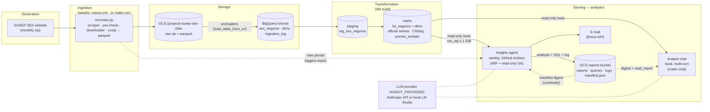

# susep-ses-pipeline

[](https://github.com/willp12/susep_data_pipeline/actions/workflows/ci.yml)

**English** · [Português (BR)](README.pt-BR.md)

Data-engineering pipeline that ingests public statistics from
[SUSEP SES](https://www2.susep.gov.br/menuestatistica/SES/principal.aspx) —
the statistics system of Brazil's private-insurance regulator — into BigQuery,
using GCS as intermediate storage and dbt for transformations.

> **Status:** active — weekly ingestion and insights report via GitHub Actions;
> local analyst chat; Terraform-managed infra; a self-hosted Airflow DAG runs
> in parallel (see [Orchestration](#orchestration-self-hosted-airflow)).

## Stack

- Python 3.12 (exact)
- [uv](https://docs.astral.sh/uv/) as package manager
- httpx + selectolax (scraping)
- polars (CSV processing)
- google-cloud-bigquery + google-cloud-storage (single-cloud: GCP only)
- dbt-core / dbt-bigquery (>=1.11,<1.12)
- pydantic v2, structlog
- [Claude Agent SDK](https://docs.anthropic.com/en/api/agent-sdk) (insights agent + chat)
- Streamlit (chat UI) · Brevo (transactional e-mail) · Tavily (news, optional)
- Terraform (GCP infra: datasets, buckets, service accounts, IAM, WIF)
- ruff, mypy, pre-commit, pytest

## Architecture

The flow follows the data-engineering lifecycle — generation → ingestion →
storage → transformation → serving:



Design points:

- **`fct_seguros` is the contract**: the agent and the chat preferentially read
  the curated fact table (built-in dedup, official names via the dims,
  pre-computed metrics).
- **The GCS bucket is the source of truth for reports** — no reports in git;
  `manifest.json` (dates + titles) gives runs cheap memory/continuity.
- **Same core, two modes**: the weekly agent (one-shot) and the chat
  (multi-turn) share tools, gate, glossary, history and the provider toggle —
  Claude API or local LM Studio.

## Example output

A real report generated by the agent on SUSEP's public data, with the analysis
kept separate from the SQL that backs it (both artifacts are written in
Portuguese, the language of the underlying market):

- 📄 **[Insights report](docs/example-report.md)** — the analysis, in markdown
- 🔎 **[Query appendix](docs/example-queries.sql.md)** — the SQL behind every number (cited by `query_no`)

Excerpt from the executive summary (_new angle_ mode; translated):

> Private pension products (PGBL/VGBL) reported in the SES field
> `premio_emitido_cap` moved R$ 194 bn in 2024 — a volume equivalent to **the
> entire conventional insurance market** — and contracted −18.7% in 2025, with
> the drop concentrated in the second half.

On every run the agent picks a mode (deep-dive on a thread from a previous
report, or a brand-new angle), cites queries by number and publishes analysis
+ appendix + run log to the GCS bucket.

## Local setup

### Prerequisites

1. **Python 3.12** — `uv` installs it automatically if missing.
2. **uv** — install per the [official docs](https://docs.astral.sh/uv/).
3. **Google Cloud SDK** — `gcloud --version` must respond.

### Installation

```bash
# Clone and enter the directory
git clone https://github.com/willp12/susep_data_pipeline.git
cd susep_data_pipeline

# Sync dependencies (creates .venv automatically) and install pre-commit
make install

# Or manually:
uv sync --all-groups
uv run pre-commit install
```

### Environment check

After `uv sync`, run:

```bash
uv run python -c "import dbt.version; print(dbt.version.__version__)"
uv run python -c "import polars; print(polars.__version__)"
```

Both must run without errors. If there is a `pyarrow`/`protobuf` conflict
between polars and dbt-bigquery, open an issue.

## First run (infra)

The infra is **Terraform** (`infra/`) — datasets, buckets, service accounts,
IAM and WIF. See [`infra/README.md`](infra/README.md):

```bash
bash infra/scripts/create-state-bucket.sh   # once (state bucket)
cd infra && terraform init && terraform apply
```

A **residual bootstrap** covers only what Terraform doesn't manage (preflight,
enabling APIs, and the `ingestion_log` table — whose schema evolves with the
code):

1. `gcloud auth application-default login` + `.env` with `GCP_PROJECT_ID`.
2. `make bootstrap` (or `bash scripts/bootstrap/run_all.sh`).

| Script                    | What it does                                                           |
| ------------------------- | ---------------------------------------------------------------------- |
| `00_preflight.sh`         | Validates GCP creds, `.env`, CLIs, and asks for interactive confirmation. |
| `02_gcp_apis.sh`          | Enables `bigquery.googleapis.com`, `storage.googleapis.com` and `iamcredentials.googleapis.com`. |
| `03_gcp_bigquery.sh`      | Ensures the datasets (idempotent, deliberately redundant with Terraform) and the `ingestion_log` table (partitioned by `ingestion_date`, clustered by `file_name`; converges new nullable columns such as `period`/`generated_at`). **Never does DELETE/DROP.** |
| `run_all.sh`              | Runs `00 → 02 → 03`, stopping at the first error.                      |

The reports/data buckets, the SAs (`bq-agent-readonly`, `susep-ingest`) + IAM
and the WIF setup have moved to Terraform (the old `04`/`05` scripts were
removed). For non-interactive runs, set `BOOTSTRAP_ASSUME_YES=1`.

## Development

| Command           | Description                                                |
| ----------------- | ---------------------------------------------------------- |
| `make install`    | Sync dependencies and install pre-commit hooks             |
| `make lint`       | ruff check + ruff format --check + mypy                    |
| `make fmt`        | Autoformat (ruff format + ruff --fix)                      |
| `make test`       | Run pytest                                                 |
| `make run`        | Run the pipeline (`python -m src.main`)                    |
| `make dbt-build`  | Run `dbt build` on the `dbt/` project                      |
| `make bootstrap`  | Run the infra provisioning scripts                         |

## Insights agent

An agent (Claude Agent SDK) that reads the BigQuery tables and writes a weekly
business-insights report. The artifacts go to the **GCS reports bucket**
(analysis, query appendix and run log) and the report lands in your **inbox**
for human review. It runs weekly on GitHub Actions (Opus; the SUSEP dataset
updates ~monthly, so a daily cadence would just re-analyse stale data);
nothing is committed to the repo.

### How it works

- **Preferred source:** `susep_ses_marts.fct_seguros` — the curated fact table
  (dedup of the latest snapshot built in, pre-computed metrics such as
  `loss_ratio`, partitioned by month). The agent may drill down into
  staging/bronze.
- **Deterministic names:** the fct carries `branch_name`, `ramo_group_name`,
  `entity_name` and `economic_group_name` (joins from the `dim_*` tables), so
  the agent never has to guess labels. The dims come from the SES domain
  tables, loaded by `uv run python -m src.bronze.unzip_dims <zip>`.
- **CNSeg taxonomy:** besides SUSEP's own grouping of insurance lines, the fct
  carries `cnseg_segmento` / `cnseg_grupo_1` / `cnseg_grupo_2` (via
  `dim_cnseg`), a curated crosswalk maintained in the seed
  `dbt/seeds/cnseg_ramos.csv` — a market cut parallel to SUSEP's. Update it by
  re-exporting the `De_Para_Ramos` sheet.
- **Written premium:** the canonical column `premio_emitido` =
  `premio_de_seguros` + `premio_emitido_cap` (insurance + capitalization).
  `premio_emitido2` is SUSEP's raw field, kept for traceability only.
- **Tools (read-only):** `describe_table`, `sample_rows`, `run_sql` (mandatory
  dry-run + ~1 GiB per-query cap) and `read_report`.
- **Analysis separated from SQL:** the report body contains only the analysis,
  citing queries by number (the `query_no` returned by `run_sql`). The
  appendix `reports/queries/<stem>.sql.md` is assembled automatically from the
  `run_sql` call log (including rejected/failed calls) — never from the
  model's text.
- **Glossary:** column descriptions come from `dbt docs` (manifest generated by
  `dbt parse`), sourced from the `_models.yml` files. `persist_docs` also
  writes them into BigQuery on every `dbt build`, so `describe_table` returns
  the same text. Refine them to improve the insights.
- **Window:** focuses on the last 3 years of `periodo_ref`.
- **Guardrails:** default-deny gate (only the tools above), `max_turns` and
  `max_budget_usd` (config), plus the per-query byte cap.

### Cross-run memory (continuity)

Every run receives a **digest** of previous reports (dates + insight titles)
injected into the prompt, and can pull a full report via `read_report`. On
each run the agent picks a **mode** (declared in the summary):

- **deep-dive** — digs into a thread from a previous report, or
- **new angle** — investigates something not yet covered.

Repeating a finding with the same framing is forbidden; revisiting a metric is
only allowed when there is new information (a new month, a new cut, a cause).

The history comes from the **GCS bucket's `manifest.json`** (dates + titles;
one cheap GET per run), and `read_report` downloads the report from the bucket
— a published report is visible to the next run immediately, with no PR merge
to wait for. Old in-repo reports enter the bucket via a one-off backfill:

```bash
uv run python scripts/backfill_reports_to_gcs.py   # idempotent
```

### E-mail delivery

After publishing to GCS, the run e-mails the report through
[Brevo](https://www.brevo.com)'s transactional API: the analysis rendered as
the HTML body + the `.md` files (report and query appendix) attached.
Configured via env — `BREVO_API_KEY` (Brevo > SMTP & API > API keys),
`REPORT_EMAIL_FROM` (a sender **verified** in Brevo, under Senders & IPs) and
`REPORT_EMAIL_TO` (accepts a comma-separated list). If any of them is missing
the send is **skipped** with a warning; delivery is best-effort and never
fails the run (the report is already published).

### Running locally

```bash
# Prerequisites: ANTHROPIC_API_KEY (or CLAUDE_CODE_OAUTH_TOKEN, see below)
# in .env, the Claude Code CLI installed and the reports bucket created
npm install -g @anthropic-ai/claude-code
uv run dbt parse --project-dir dbt --profiles-dir dbt   # builds the glossary
uv run python -m src.agent.main   # publishes to GCS + scratch copy in reports/
```

## Analyst chat

A multi-turn chat (`src/chat/`) for talking about the published reports and
digging deeper: the agent receives the manifest digest (dates + titles), pulls
full reports via `read_report` (with the appendix SQL) and runs fresh BigQuery
queries — same tools, same default-deny gate and same provider toggle
(Anthropic or local LM Studio) as the weekly agent.

```bash
make chat-ui     # web UI (Streamlit, http://localhost:8501)
make chat        # or the terminal REPL: uv run python -m src.chat.cli
```

In the UI: a sidebar with the published reports (dates + titles from the
manifest, an **Explore** button to pull a report into the conversation),
answers with the tool calls visible (`read_report`, `run_sql`…), session cost
(anthropic provider) and **New conversation** to reset the context. The
conversation lives in a multi-turn `ChatSession` per browser tab (sync/async
bridge in `src/chat/bridge.py`).

REPL commands: `/reports` (topics already covered), `/custo` (session cost),
`/sair` (quit). Guardrails: `CHAT_MAX_TURNS` per question and
`CHAT_MAX_BUDGET_USD` for the whole conversation (anthropic provider only;
local is free). Prerequisites: populated bucket + GCP credentials; `dbt parse`
enriches the glossary (optional).

**Web news (optional):** with a `TAVILY_API_KEY` in `.env` (free tier at
<https://tavily.com>), the chat gains the `search_news` tool — recent news
about insurers (partnerships, M&A, regulation) as **context** for the numbers,
always cited with source + date + link, never as a source of figures. Capped
at `NEWS_MAX_SEARCHES` searches per conversation (default 5). Without the key
the tool isn't registered and nothing changes. (Enabling it in the weekly
report is a future PR.)

### Running with a local model (LM Studio)

LM Studio (>= 0.4.1) exposes an **Anthropic-compatible** endpoint
(`/v1/messages`), so the same Agent SDK works pointed at it — no Anthropic API
key required:

1. In LM Studio: load the model with a **context window >= 25k tokens** (the
   SDK is context-heavy) and start the local server (Developer tab, port 1234).
2. In `.env`:

   ```
   AGENT_PROVIDER=local
   AGENT_MODEL=google/gemma-3-27b      # the model id in LM Studio
   LMSTUDIO_BASE_URL=http://localhost:1234
   ```

3. `uv run python -m src.agent.main` — publishes to GCS and sends the e-mail
   as usual (the USD budget cap doesn't apply; `AGENT_MAX_TURNS` still does).

> **Caveat:** the agent depends on reliable *tool calling* (many `run_sql`
> calls). Gemma is weak at it; if it doesn't emit tool calls properly, models
> like **Qwen3** (14B / 30B-A3B) have much better native function calling in
> LM Studio. The Anthropic path remains the weekly workflow's default — local
> mode is manual/experimental.

### In production (GitHub Actions)

- **`insights.yml`** — **weekly** `schedule` (Mondays 14:00 UTC, ~2 h after
  the ingest) + `workflow_dispatch`. Runs with `AGENT_MODEL=opus` and a
  US$ 1.25/run budget (the local default stays sonnet/0.75). Authenticates to
  GCP via Workload Identity Federation (SA `bq-agent-readonly`: BigQuery read
  + `objectAdmin` on the reports bucket), runs the agent, **publishes to GCS**
  and sends the e-mail. Nothing is committed to the repo; the scratch copies
  become a workflow artifact (7 days) as a safety net. Every trigger produces
  a **new** report: the day's first is `YYYY-MM-DD`, reruns get suffixes `_2`,
  `_3`… (reserved in the bucket manifest). Overlapping runs are allowed (no
  `cancel-in-progress`).
- **`ingest.yml`** — **weekly** `schedule` (Mondays) + `workflow_dispatch`.
  Authenticates to GCP with a **JSON key** (`GCP_SA_KEY`, the write SA
  `susep-ingest`), runs `python -m src.main`
  (scrape → cheap pre-check → ingest only on change → `dbt build`). On a new
  period: a notice e-mail (sent by the pipeline itself) + triggers
  `insights.yml`. One ingest at a time (`concurrency`), since it writes to
  GCS/BQ and rebuilds the marts.
- **`ci.yml`** — on push/PR: ruff + mypy + pytest + secret scan (gitleaks).
- **Required secrets/vars:** secrets `ANTHROPIC_API_KEY` (or
  `CLAUDE_CODE_OAUTH_TOKEN` — bills the subscription, see below),
  `GCP_WIF_PROVIDER`, `GCP_AGENT_SA` (insights, read-only), `GCP_SA_KEY`
  (ingestion, write), `BREVO_API_KEY`, `REPORT_EMAIL_FROM`,
  `REPORT_EMAIL_TO`; variable `GCP_PROJECT_ID`.
- **Subscription billing (optional):** `claude setup-token` (Pro/Max plan)
  generates a ~1-year OAuth token; saved as the `CLAUDE_CODE_OAUTH_TOKEN`
  secret it **wins** over the API key and agent runs consume the
  subscription's quota (shared with interactive Claude Code usage) instead of
  API credits. To go back to the API, just delete the secret.
  `AGENT_MAX_BUDGET_USD` still applies as a guardrail (cost becomes an
  estimate).

### Git workflow

- Work happens on feature branches (`feat/`, `fix/`, `chore/`) merged into
  `main` via PR; every PR runs CI (ruff + mypy + pytest + secret scan).
- [Conventional Commits](https://www.conventionalcommits.org/).

## Repository layout

```
susep-ses-pipeline/
├── .github/workflows/            # ci.yml (lint/test/secret-scan) · ingest.yml · insights.yml
├── infra/                        # Terraform (datasets, buckets, SAs, IAM, WIF)
├── scripts/
│   ├── bootstrap/                # residual provisioning (APIs + ingestion_log)
│   └── backfill_reports_to_gcs.py
├── src/
│   ├── main.py                   # ingestion pipeline entrypoint
│   ├── config.py                 # loads env vars
│   ├── ingestion/                # scraper, hasher, downloader
│   ├── bronze/                   # unzip → parquet
│   ├── storage/                  # GCS object I/O (upload/download/parse gs://)
│   ├── loaders/                  # GCS → BigQuery (load_table_from_uri)
│   ├── state/                    # ingestion_log
│   ├── agent/                    # insights agent (tools, glossary, history, prompt)
│   └── chat/                     # multi-turn analyst chat (CLI + Streamlit)
├── dbt/
│   ├── models/                   # staging (view) + marts (fct_seguros + dims)
│   ├── seeds/                    # cnseg_ramos.csv (CNSeg lines crosswalk)
│   └── macros/                   # br_to_numeric, generate_schema_name
├── reports/                      # local run scratch (source of truth = GCS bucket)
├── tests/                        # mirrors src/ (pytest + fakes; no network/creds)
└── pyproject.toml
```

## Orchestration (self-hosted Airflow)

The weekly run also exists as the **`susep_weekly`** DAG on the self-hosted
[Airflow platform](https://github.com/willp12/airflow) (GCP Spot VM,
DockerOperator) — see that repo's `docs/integration-guide.md` for the
integration contract.

- **Deploy** — `.github/workflows/deploy.yml`: on every push to `main` it
  builds the task image from this repo's `Dockerfile` (pushed to Artifact
  Registry as `pipelines/susep_data_pipeline:latest` + `:git-sha`) and rsyncs
  `dags/` to the platform's DAGs bucket (`dags/susep_data_pipeline/`). It
  authenticates with the platform's WIF pair — repo *variables*
  `GCP_AIRFLOW_WIF_PROVIDER` / `GCP_AIRFLOW_DEPLOYER_SA` — distinct from the
  `GCP_WIF_PROVIDER`/`GCP_AGENT_SA` *secrets* that belong to `insights.yml`.
- **DAG** — `dags/susep.py`: `run_pipeline >> insights_gate >> run_insights`,
  both tasks on the same image (`uv run python -m src.main`; then `dbt parse`
  + `python -m src.agent.main`). The explicit dependency replaces the fragile
  2-hour gap between the two GitHub Actions crons: the agent runs iff the
  ingest succeeded.
- **Parallel-run status** — the GitHub Actions crons (`ingest.yml`,
  `insights.yml`) remain the production schedulers for now. The DAG runs
  Mondays **15:00 UTC** (3 h after the GH ingest, so the two never overlap);
  its ingest no-ops cheaply on the unchanged SUSEP hash, and the insights task
  defaults **off** (`params.insights=false`) so the weekly report and e-mail
  aren't duplicated — manual validation runs pass `{"insights": true}`. At
  cutover: remove `schedule:` from both workflows (keep `workflow_dispatch`
  as a fallback), revert the DAG cron to `0 12 * * 1` and flip the insights
  default to `true`.
- **Secrets** — resolved at runtime from GCP Secret Manager through the
  Airflow secrets backend (`{{ var.value.anthropic_api_key }}`,
  `claude_code_oauth_token`, `brevo_api_key`); nothing in DAG code or baked
  into the image. The report e-mail addresses resolve the same way
  (`report_email_to` / `report_email_from`, empty fallback — the e-mail
  steps log+skip while unset): not secrets, but operator PII kept out of
  the repo.
- **Single-SA trade-off** — CI keeps the least-privilege split (insights runs
  as the read-only `bq-agent-readonly` via WIF; ingest as `susep-ingest`).
  On Airflow, both tasks run as the VM's single SA (`airflow-vm@`, ADC from
  the metadata server, no key files; data-side grants live in `infra/`), so
  the insights task technically holds write access it doesn't need. Accepted
  for a solo-maintained platform; the documented hardening path is per-task
  service accounts via SA impersonation inside the containers.

## Out of scope (for now)

- The other fact CSVs in the zip (reinsurance, capitalization, private
  pension…); the domain/lookup tables are already ingested.
- dbt silver/gold layers and dev vs prod separation.
- Migrating the ingest to WIF (it uses a SA JSON key today) and Slack alerts.

## License

[MIT](LICENSE).
