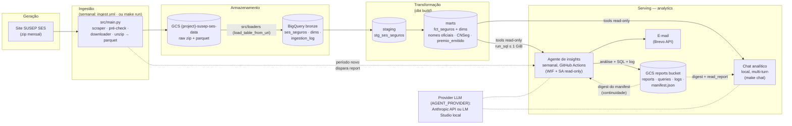

# susep-ses-pipeline

Pipeline de engenharia de dados que ingere estatísticas públicas do
[SUSEP SES](https://www2.susep.gov.br/menuestatistica/SES/principal.aspx) para
BigQuery, usando GCS como storage intermediário e dbt para transformações.

> **Status:** MVP — Fase 1 (rodada manual, local, um único arquivo end-to-end).

## Stack

- Python 3.12 (exato)
- [uv](https://docs.astral.sh/uv/) como package manager
- httpx + selectolax (scraping)
- polars (processamento CSV)
- google-cloud-bigquery + google-cloud-storage (single-cloud: GCP only)
- dbt-core / dbt-bigquery (>=1.11,<1.12)
- pydantic v2, structlog
- ruff, mypy, pre-commit, pytest

## Arquitetura

O fluxo segue o lifecycle de engenharia de dados — geração → ingestão →
armazenamento → transformação → serving:



Pontos de desenho:

- **`fct_seguros` é o contrato**: agente e chat leem preferencialmente o fato
  curado (dedup embutido, nomes oficiais via dims, métricas pré-computadas).
- **O bucket GCS é a fonte de verdade dos reports** — nada de report no git; o
  `manifest.json` (datas + títulos) dá memória/continuidade barata aos runs.
- **Mesmo núcleo, dois modos**: o agente semanal (one-shot) e o chat
  (multi-turn) compartilham tools, gate, glossário, histórico e o toggle de
  provider — Claude API ou LM Studio local.

## Setup local

### Pré-requisitos

1. **Python 3.12** — o `uv` cuida de instalar caso não esteja presente.
2. **uv** — instalar conforme [docs oficiais](https://docs.astral.sh/uv/).
3. **Google Cloud SDK** — `gcloud --version` deve responder.

### Instalação

```bash
# Clone e entra no diretório
git clone <repo-url> susep-ses-pipeline
cd susep-ses-pipeline

# Sincroniza dependências (cria .venv automaticamente) e instala pre-commit
make install

# Ou manualmente:
uv sync --all-groups
uv run pre-commit install
```

### Validação do ambiente

Após `uv sync`, rode:

```bash
uv run python -c "import dbt.version; print(dbt.version.__version__)"
uv run python -c "import polars; print(polars.__version__)"
```

Ambos devem rodar sem erro. Se houver conflito de `pyarrow`/`protobuf` entre
polars e dbt-bigquery, reportar antes de prosseguir.

## Primeira execução (infra)

A infra é **Terraform** (`infra/`) — datasets, buckets, service accounts, IAM e
WIF. Ver [`infra/README.md`](infra/README.md):

```bash
bash infra/scripts/create-state-bucket.sh   # uma vez (bucket de state)
cd infra && terraform init && terraform apply
```

Um **bootstrap residual** cobre só o que o Terraform não gerencia (preflight,
habilitar APIs, e a tabela `ingestion_log` — cujo schema evolui com o código):

1. `gcloud auth application-default login` + `.env` com `GCP_PROJECT_ID`.
2. `make bootstrap` (ou `bash scripts/bootstrap/run_all.sh`).

| Script                    | O que faz                                                              |
| ------------------------- | ---------------------------------------------------------------------- |
| `00_preflight.sh`         | Valida GCP creds, `.env`, CLIs, e pede confirmação interativa.        |
| `02_gcp_apis.sh`          | Habilita `bigquery.googleapis.com`, `storage.googleapis.com` e `iamcredentials.googleapis.com`. |
| `03_gcp_bigquery.sh`      | Garante a tabela `ingestion_log` (particionada por `ingestion_date`, clusterizada por `file_name`; converge colunas nullable novas como `period`/`generated_at`). Os datasets são do Terraform. **Nunca faz DELETE/DROP.** |
| `run_all.sh`              | Roda `00 → 02 → 03`, para no primeiro erro.                            |

Os buckets de reports/dados, as SAs (`bq-agent-readonly`, `susep-ingest`) + IAM
e o WIF migraram pro Terraform (antigos `04`/`05` removidos). Para rodar
não-interativamente, setar `BOOTSTRAP_ASSUME_YES=1`.

## Desenvolvimento

| Comando           | Descrição                                                  |
| ----------------- | ---------------------------------------------------------- |
| `make install`    | Sincroniza dependências e instala hooks de pre-commit      |
| `make lint`       | ruff check + ruff format --check + mypy                    |
| `make fmt`        | Autoformata (ruff format + ruff --fix)                     |
| `make test`       | Roda pytest                                                |
| `make run`        | Executa a pipeline (`python -m src.main`)                  |
| `make dbt-build`  | Roda `dbt build` no projeto `dbt/`                         |
| `make bootstrap`  | Executa scripts de provisionamento de infra                |

## Agente de insights

Um agente (Claude Agent SDK) que lê as tabelas do BigQuery e gera um relatório
semanal de insights de negócio. Os artefatos vão pro **bucket GCS de reports**
(análise, apêndice de queries e run log) e o report chega por **e-mail** pra
revisão humana. Roda semanalmente via GitHub Actions (Opus; a base SUSEP
atualiza ~mensalmente, então cadência diária só re-analisava dado parado);
nada é commitado no repo.

### Como funciona

- **Fonte preferida:** `susep_ses_marts.fct_seguros` — fato curado (dedup do
  snapshot mais recente embutido, métricas pré-computadas como `loss_ratio`,
  particionado por mês). O agente pode descer pro staging/bronze pra drill-down.
- **Nomes determinísticos:** a fct traz `branch_name`, `ramo_group_name`,
  `entity_name` e `economic_group_name` (joins das `dim_*`), pra o agente não
  inferir rótulos. As dims vêm das tabelas de domínio do SES, carregadas por
  `uv run python -m src.bronze.unzip_dims <zip>` (Fase 2).
- **Taxonomia CNSeg:** além do grupo de ramos SUSEP, a fct traz
  `cnseg_segmento` / `cnseg_grupo_1` / `cnseg_grupo_2` (via `dim_cnseg`), um
  de-para curado mantido no seed `dbt/seeds/cnseg_ramos.csv` — corte de mercado
  paralelo ao da SUSEP. Atualize re-exportando a aba `De_Para_Ramos`.
- **Prêmio emitido:** a coluna canônica `premio_emitido` = `premio_de_seguros`
  + `premio_emitido_cap` (seguros + capitalização). `premio_emitido2` é o campo
  cru da SUSEP, mantido só pra rastreabilidade.
- **Tools (read-only):** `describe_table`, `sample_rows`, `run_sql` (com dry-run
  obrigatório + cap de ~1 GiB por query) e `read_report`.
- **Análise separada do SQL:** o corpo do report contém só a análise, citando
  queries por número (`query_no` retornado pelo `run_sql`). O apêndice
  `reports/queries/<stem>.sql.md` é montado automaticamente a partir do log de
  chamadas `run_sql` (incluindo rejeitadas/falhas) — nunca a partir do texto do
  modelo.
- **Glossário:** as descrições de coluna vêm do `dbt docs` (manifest gerado por
  `dbt parse`), a partir dos `_models.yml`. Refine-os pra melhorar os insights.
- **Janela:** foca nos últimos 3 anos de `periodo_ref`.
- **Guardrails:** gate default-deny (só as tools acima), `max_turns` e
  `max_budget_usd` (config), além do cap de bytes por query.

### Memória entre runs (continuidade)

Cada run recebe um **digest** dos reports anteriores (datas + títulos dos
insights) injetado no prompt, e pode puxar um report inteiro via `read_report`.
A cada execução o agente escolhe um **modo** (declarado no sumário):

- **deep-dive** — aprofunda um fio de um report anterior, ou
- **novo ângulo** — investiga algo ainda não coberto.

Repetir um achado com o mesmo enquadramento é proibido; só vale reabordar uma
métrica se houver informação nova (novo mês, recorte, causa).

O histórico vem do **`manifest.json` do bucket GCS** (datas + títulos; 1 GET
barato por run), e `read_report` baixa o report do bucket — um report publicado
fica visível pro run seguinte imediatamente, sem esperar merge de PR. Reports
antigos do repo entram no bucket via backfill one-off:

```bash
uv run python scripts/backfill_reports_to_gcs.py   # idempotente
```

### Entrega por e-mail

Depois de publicar no GCS, o run envia o report por e-mail via a API
transacional do [Brevo](https://www.brevo.com): corpo HTML renderizado da
análise + os `.md` (report e apêndice de queries) anexados. Configuração via
env — `BREVO_API_KEY` (Brevo > SMTP & API > API keys), `REPORT_EMAIL_FROM`
(remetente **verificado** no Brevo, em Senders & IPs) e `REPORT_EMAIL_TO`
(aceita lista separada por vírgula). Se faltar qualquer um, o envio é
**pulado** com warning; o envio é best-effort e nunca falha o run (o report já
está publicado).

### Rodar localmente

```bash
# Pré-requisitos: ANTHROPIC_API_KEY (ou CLAUDE_CODE_OAUTH_TOKEN, ver abaixo)
# no .env, CLI do Claude Code instalada e o bucket de reports criado
npm install -g @anthropic-ai/claude-code
uv run dbt parse --project-dir dbt --profiles-dir dbt   # gera o glossário
uv run python -m src.agent.main   # publica no GCS + cópia scratch em reports/
```

## Chat analítico

Um chat multi-turn (`src/chat/`) pra conversar sobre os reports publicados e
aprofundar temas: o agente recebe o digest do manifest (datas + títulos),
puxa reports inteiros via `read_report` (com o SQL do apêndice) e roda queries
novas no BigQuery — mesmas tools, mesmo gate default-deny e mesmo toggle de
provider (Anthropic ou LM Studio local) do agente semanal.

```bash
make chat-ui     # interface web (Streamlit, http://localhost:8501)
make chat        # ou o REPL no terminal: uv run python -m src.chat.cli
```

Na UI: sidebar com os reports publicados (datas + títulos do manifest, botão
**Explorar** pra puxar um report pra conversa), respostas com as tool calls
visíveis (`read_report`, `run_sql`…), custo da sessão (provider anthropic) e
**Nova conversa** pra zerar o contexto. A conversa vive numa `ChatSession`
multi-turn por aba do navegador (ponte sync/async em `src/chat/bridge.py`).

Comandos no REPL: `/reports` (temas já cobertos), `/custo`, `/sair`.
Guardrails: `CHAT_MAX_TURNS` por pergunta e `CHAT_MAX_BUDGET_USD` pra conversa
inteira (só no provider anthropic; local é grátis). Pré-requisitos: bucket
populado + credenciais GCP; `dbt parse` enriquece o glossário (opcional).

**Notícias da web (opcional):** com `TAVILY_API_KEY` no `.env` (free tier em
<https://tavily.com>), o chat ganha a tool `search_news` — notícias recentes
sobre seguradoras (parcerias, M&A, regulação) como **contexto** dos números,
sempre citadas com fonte + data + link, nunca como fonte de cifras. Cap de
`NEWS_MAX_SEARCHES` buscas por conversa (default 5). Sem a key, a tool não é
registrada e nada muda. (Habilitar no report semanal vem num próximo PR.)

### Rodar com modelo local (LM Studio)

O LM Studio (>= 0.4.1) expõe um endpoint **Anthropic-compatible** (`/v1/messages`),
então o mesmo Agent SDK funciona apontado pra ele — sem API key da Anthropic:

1. No LM Studio: carregar o modelo com **contexto >= 25k tokens** (o SDK é
   pesado em contexto) e ligar o servidor local (aba Developer, porta 1234).
2. No `.env`:

   ```
   AGENT_PROVIDER=local
   AGENT_MODEL=google/gemma-3-27b      # id do modelo no LM Studio
   LMSTUDIO_BASE_URL=http://localhost:1234
   ```

3. `uv run python -m src.agent.main` — publica no GCS e envia e-mail normalmente
   (o cap de budget USD não se aplica; `AGENT_MAX_TURNS` continua valendo).

> **Caveat:** o agente depende de *tool calling* confiável (muitas chamadas de
> `run_sql`). O Gemma é fraco nisso; se ele não emitir tool calls direito,
> modelos como **Qwen3** (14B / 30B-A3B) têm function calling nativo bem melhor
> no LM Studio. O caminho Anthropic segue sendo o default do workflow semanal —
> o modo local é manual/experimental.

### Em produção (GitHub Actions)

- **`insights.yml`** — `schedule` **semanal** (segundas 14:00 UTC, ~2h depois
  do ingest) + `workflow_dispatch`. Roda com `AGENT_MODEL=opus` e budget de
  US$ 1,25/run (o default local segue sonnet/0,75). Autentica no GCP
  via Workload Identity Federation (SA `bq-agent-readonly`: leitura no BQ +
  `objectAdmin` no bucket de reports), roda o agente, **publica no GCS** e envia
  o e-mail. Nada é commitado no repo; as cópias scratch viram artifact do
  workflow (7 dias) como rede de segurança. Cada disparo gera um report
  **novo**: o 1º do dia é `YYYY-MM-DD`, reruns ganham sufixo `_2`, `_3`…
  (reservado no manifest do bucket). Runs sobrepostos são permitidos (sem
  `cancel-in-progress`).
- **`ingest.yml`** — `schedule` **semanal** (segundas) + `workflow_dispatch`.
  Autentica no GCP por **chave JSON** (`GCP_SA_KEY`, a SA de escrita
  `susep-ingest`), roda `python -m src.main`
  (scrape → pré-check barato → ingere só se mudou → `dbt build`). Em período
  novo: e-mail de aviso (pelo próprio pipeline) + dispara o `insights.yml`.
  Um ingest por vez (`concurrency`), pois escreve no GCS/BQ e reconstrói os
  marts.
- **`ci.yml`** — em push/PR: ruff + mypy + pytest + scan de segredos (gitleaks).
- **Secrets/vars necessários:** secrets `ANTHROPIC_API_KEY` (ou
  `CLAUDE_CODE_OAUTH_TOKEN` — cobra na assinatura, ver abaixo),
  `GCP_WIF_PROVIDER`, `GCP_AGENT_SA` (insights, read-only), `GCP_SA_KEY`
  (ingestão, escrita), `BREVO_API_KEY`, `REPORT_EMAIL_FROM`,
  `REPORT_EMAIL_TO`; variável `GCP_PROJECT_ID`.
- **Cobrança por assinatura (opcional):** `claude setup-token` (plano Pro/Max)
  gera um token OAuth de ~1 ano; salvo como secret `CLAUDE_CODE_OAUTH_TOKEN`,
  ele **vence** a API key e os runs do agente passam a consumir a cota da
  assinatura (compartilhada com o uso interativo do Claude Code) em vez de
  créditos de API. Para voltar pra API, basta deletar o secret. O
  `AGENT_MAX_BUDGET_USD` segue valendo como guardrail (custo vira estimativa).

### Git workflow

- `main` é protegida: toda mudança entra via PR.
- Trabalho acontece em feature branches (`feat/`, `fix/`, `chore/`) que mergeiam
  em `develop`. Depois `develop` → `main` via PR.
- [Conventional Commits](https://www.conventionalcommits.org/) obrigatório.

## Estrutura

```
susep-ses-pipeline/
├── .github/workflows/            # insights.yml (agente) + ci.yml (lint/test/secret-scan)
├── scripts/bootstrap/            # provisionamento (vira Terraform na Fase 6)
├── src/
│   ├── main.py                   # entrypoint da pipeline
│   ├── config.py                 # carrega env vars
│   ├── ingestion/                # scraper, hasher, downloader
│   ├── bronze/                   # unzip → parquet
│   ├── storage/                  # GCS object I/O (upload/download/parse gs://)
│   ├── loaders/                  # GCS → BigQuery (load_table_from_uri)
│   ├── state/                    # ingestion_log
│   └── agent/                    # agente de insights (tools, glossário, histórico, prompt)
├── dbt/
│   └── models/
│       ├── staging/              # stg_ses_seguros (view)
│       └── marts/                # fct_seguros (fato curado lido pelo agente)
├── reports/                      # scratch local do run (fonte de verdade = bucket GCS)
├── tests/
└── pyproject.toml
```

## Fora de escopo neste MVP

- Terraform (Fase 6)
- Demais CSVs de dados do zip (as tabelas de domínio/lookup já são ingeridas; os
  outros CSVs de fato — resseguros, cap, prev, etc. — seguem fora de escopo)
- Camadas silver/gold no dbt (Fase 3)
- Separação dev vs prod (Fase 3)
- Slack alerts (Fase 5)
